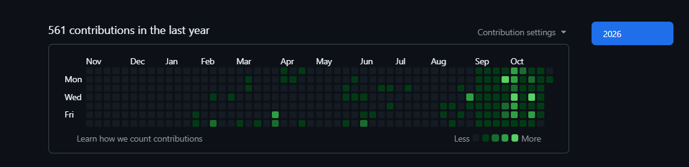

Contribution snapshot · GitHub's live contribution calendar below reflects new activity.

<h2 align="center">Projects by Technology</h2>

<strong>Immersive experiences · AI systems · Full stack applications</strong>

Explore my work in virtual reality, augmented reality, Unity simulations, machine learning, and generative AI.

<!-- PROJECT-DIRECTORY:START -->

### Explore a technology

Choose a section below, or open its matching filter in the **Repositories** tab.

| Technology | Projects | Filter repositories |
| --- | ---: | --- |
| **[Virtual Reality / XR](#virtual-reality--xr)** | **9** | [Browse projects →](https://github.com/bhargavm-iiits?tab=repositories&q=topic%3Avirtual-reality) |
| **[Augmented Reality](#augmented-reality)** | **4** | [Browse projects →](https://github.com/bhargavm-iiits?tab=repositories&q=topic%3Aaugmented-reality) |
| **[Unity Games / Simulations](#unity-games--simulations)** | **2** | [Browse projects →](https://github.com/bhargavm-iiits?tab=repositories&q=topic%3Aunity-simulation) |
| **[Machine Learning / Deep Learning](#machine-learning--deep-learning)** | **3** | [Browse projects →](https://github.com/bhargavm-iiits?tab=repositories&q=topic%3Amachine-learning) |
| **[Generative AI / LLMs / RAG](#generative-ai--llms--rag)** | **7** | [Browse projects →](https://github.com/bhargavm-iiits?tab=repositories&q=topic%3Agenerative-ai) |
| **[Full Stack Applications / Tools](#full-stack-applications--tools)** | **3** | [Browse projects →](https://github.com/bhargavm-iiits?tab=repositories&q=topic%3Afull-stack) |
| **[Frontend / 3D Portfolios](#frontend--3d-portfolios)** | **2** | [Browse projects →](https://github.com/bhargavm-iiits?tab=repositories&q=topic%3Aportfolio) |

---

### 🥽 Virtual Reality / XR

**9 projects** · [View this category in Repositories →](https://github.com/bhargavm-iiits?tab=repositories&q=topic%3Avirtual-reality)

#### [Industry-Air-Craft-V1](https://github.com/bhargavm-iiits/Industry-Air-Craft-V1)

Aviation scene and XR prototype

**Built with:** Unity · C# · URP · XR Interaction Toolkit

#### [Industry-AIR_CRAFT](https://github.com/bhargavm-iiits/Industry-AIR_CRAFT)

VR engine assembly training

**Built with:** Unity · C# · VRTK · SteamVR/OpenVR

#### [Interactive-Chemistry](https://github.com/bhargavm-iiits/Interactive-Chemistry)

VR crystallography and XRD laboratory

**Built with:** Unity · C# · Meta XR SDK · OpenXR

#### [Interactive-Speed](https://github.com/bhargavm-iiits/Interactive-Speed)

Game-based speed learning with XR dependencies

**Built with:** Unity · C# · OpenXR

#### [Motion-in-Straight-Line](https://github.com/bhargavm-iiits/Motion-in-Straight-Line)

Interactive motion learning

**Built with:** Unity · C# · XR Interaction Toolkit · OpenXR

#### [Teaching-and-Learning](https://github.com/bhargavm-iiits/Teaching-and-Learning)

Physics learning

**Built with:** Unity · C# · XR Interaction Toolkit · OpenXR

#### [Teaching-and-Learning_V1](https://github.com/bhargavm-iiits/Teaching-and-Learning_V1)

VR kinematics suite

**Built with:** Unity · C# · URP · XR · OpenXR

#### [VR-Plant-Treatment](https://github.com/bhargavm-iiits/VR-Plant-Treatment)

Plant-disease education and treatment visualization

**Built with:** Unity · C# · URP · OpenXR

#### [VR_Demo_Cymax](https://github.com/bhargavm-iiits/VR_Demo_Cymax)

VR cinema and 360° video

**Built with:** React · Three.js · React Three Fiber/XR · FastAPI

---

### 📍 Augmented Reality

**4 projects** · [View this category in Repositories →](https://github.com/bhargavm-iiits?tab=repositories&q=topic%3Aaugmented-reality)

#### [AR-Navigation](https://github.com/bhargavm-iiits/AR-Navigation)

Alipiri–Tirumala outdoor navigation

**Built with:** Unity · C# · AR Foundation · ARCore · GPS

#### [AR-Pages-Tirumala](https://github.com/bhargavm-iiits/AR-Pages-Tirumala)

Pilgrimage navigation and landmarks

**Built with:** Unity · C# · AR Foundation · ARCore Extensions

#### [AR_Tirumala](https://github.com/bhargavm-iiits/AR_Tirumala)

AR navigation placeholder

**Built with:** repository currently empty

#### [Navigation-AR-pages](https://github.com/bhargavm-iiits/Navigation-AR-pages)

AR navigation scenes

**Built with:** Unity · AR Foundation · ARCore · URP

---

### 🎮 Unity Games / Simulations

**2 projects** · [View this category in Repositories →](https://github.com/bhargavm-iiits?tab=repositories&q=topic%3Aunity-simulation)

#### [Unity-Linear-Motion-](https://github.com/bhargavm-iiits/Unity-Linear-Motion-)

Linear motion, acceleration, speed, and velocity

**Built with:** Unity assets · C# · animation

#### [Velocity---Interactive](https://github.com/bhargavm-iiits/Velocity---Interactive)

Interactive game with checkpoints, compass, and collectibles

**Built with:** Unity · C# · terrain

---

### 🧠 Machine Learning / Deep Learning

**3 projects** · [View this category in Repositories →](https://github.com/bhargavm-iiits?tab=repositories&q=topic%3Amachine-learning)

#### [AI-Plant-Disease-Detection](https://github.com/bhargavm-iiits/AI-Plant-Disease-Detection)

CNN plant-disease detection

**Built with:** TensorFlow/Keras · OpenCV · Flask

#### [Hate-Speech-Detection](https://github.com/bhargavm-iiits/Hate-Speech-Detection)

Multimodal content classification

**Built with:** PyTorch · Transformers · MiniLM · CLIP · LoRA/PEFT

#### [OpthaMiss_V1](https://github.com/bhargavm-iiits/OpthaMiss_V1)

AI-assisted eye screening

**Built with:** PyTorch · timm · OpenCV · FastAPI · React

---

### ✨ Generative AI / LLMs / RAG

**7 projects** · [View this category in Repositories →](https://github.com/bhargavm-iiits?tab=repositories&q=topic%3Agenerative-ai)

#### [evidra-ai](https://github.com/bhargavm-iiits/evidra-ai)

ClaimBridge document-review prototype

**Built with:** Python · Streamlit · Anthropic · BM25 · PyMuPDF

#### [Fixproof](https://github.com/bhargavm-iiits/Fixproof)

AI code repair with verification

**Built with:** Gemini · BM25 · Docker · FastAPI · React

#### [Jarvis](https://github.com/bhargavm-iiits/Jarvis)

AI assistant prototype

**Built with:** Python · LiveKit Agents · OpenAI

#### [Privacy-Preserving-RAG](https://github.com/bhargavm-iiits/Privacy-Preserving-RAG)

Privacy-focused retrieval experiments

**Built with:** LangChain · LangGraph · ChromaDB · Presidio · MLflow

#### [Scientific_Claim_Checker](https://github.com/bhargavm-iiits/Scientific_Claim_Checker)

Evidence-based claim verification

**Built with:** LangGraph · Ollama/Qwen · hybrid retrieval · PyTorch · Streamlit

#### [Sticker_Me](https://github.com/bhargavm-iiits/Sticker_Me)

Personalized sticker generation

**Built with:** FLUX.2 Klein · FastAPI · React · Pillow · rembg

#### [Vox-Align](https://github.com/bhargavm-iiits/Vox-Align)

Emotion-aware voice assistant

**Built with:** PyTorch · BERT · Whisper · Gemini · ChromaDB

---

### 🌐 Full Stack Applications / Tools

**3 projects** · [View this category in Repositories →](https://github.com/bhargavm-iiits?tab=repositories&q=topic%3Afull-stack)

#### [Excel-to-Visualization-App-](https://github.com/bhargavm-iiits/Excel-to-Visualization-App-)

Spreadsheet-to-API compiler and 3D dependency explorer

**Built with:** FastAPI · React · Three.js · SQLAlchemy · Gemini

#### [Sheduler](https://github.com/bhargavm-iiits/Sheduler)

Cadence planning dashboard and Android companion

**Built with:** React · TypeScript · Vinext/Vite · Express · Capacitor

#### [Sri-Balaji-Bamboo-Works](https://github.com/bhargavm-iiits/Sri-Balaji-Bamboo-Works)

Bilingual storefront and order management

**Built with:** HTML · CSS · JavaScript · Node.js · encrypted storage

---

### 🎨 Frontend / 3D Portfolios

**2 projects** · [View this category in Repositories →](https://github.com/bhargavm-iiits?tab=repositories&q=topic%3Aportfolio)

#### [E-Portfolio](https://github.com/bhargavm-iiits/E-Portfolio)

Game-inspired portfolio

**Built with:** Next.js · React · TypeScript · Three.js · React Three Fiber · GSAP

#### [ML_E-Portfolio](https://github.com/bhargavm-iiits/ML_E-Portfolio)

Engineering portfolio

**Built with:** JavaScript · Three.js · GSAP · Lenis

---

New public repositories are checked hourly and grouped by their technology. Unclear projects appear under Other Projects until their category is refined.

<!-- PROJECT-DIRECTORY:END -->
